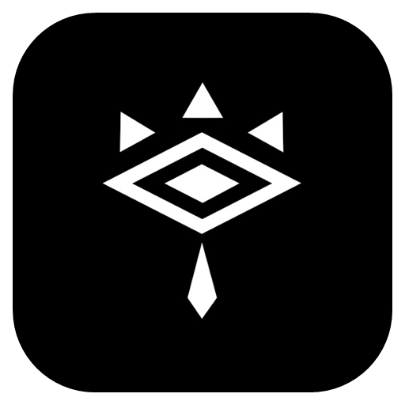
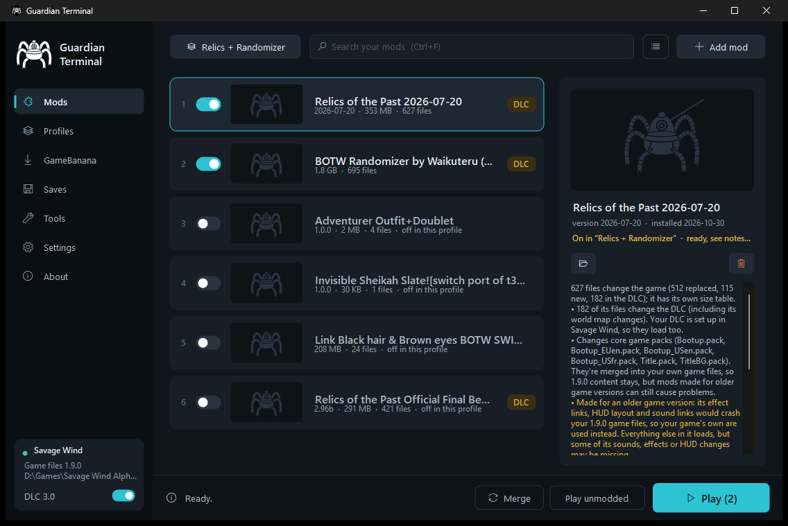
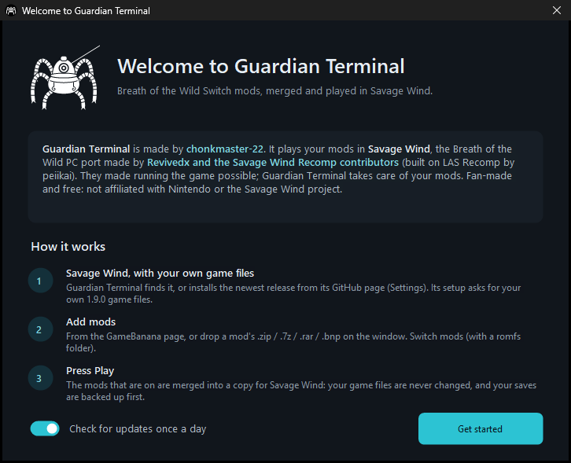
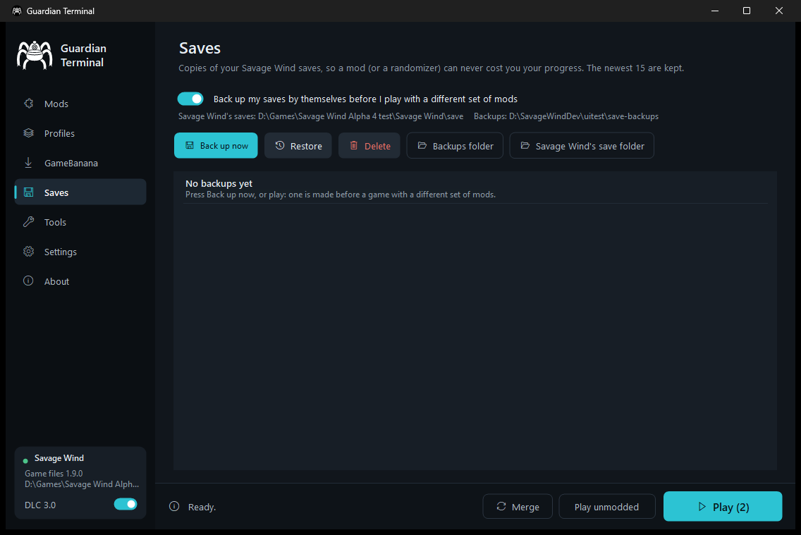

<p align="center">
  
</p>

<h1 align="center">Guardian Terminal</h1>

<p align="center">
  <b>A mod manager for <a href="https://github.com/Revivedx/SavageWindRecomp">Savage Wind</a>, the Breath of the Wild PC port.</b><br>
  Install Switch mods, let it merge them, press Play.
</p>

<p align="center">
  <a href="https://github.com/chonkmaster-22/guardian-terminal/releases/latest"></a>
  <a href="https://github.com/chonkmaster-22/guardian-terminal/releases"></a>
  
  <a href="LICENSE"></a>
</p>

<p align="center">
  
</p>

## What it does

This program loads the DLC and mods that you want to play through Savage Wind for BOTW PC port:

- **Lets you play many mods and lets you use YOUR OWN DLC.** Packs are merged file by file. Map files, spawn tables, texts, the actor list and
  the game's progress flags are merged entry by entry, so two big mods (say Relics of the Past and a randomizer)
  both keep their changes. When two mods really change the same thing, the one lower in your list wins, and
  Guardian Terminal shows you where.
- **Fixes mods made for older game versions.** Most mods were made for game version 1.6.0, and Savage Wind runs
  1.9.0. Guardian Terminal keeps 1.9.0's own files where a 1.6.0 copy would crash the game, and keeps 1.9.0's
  extra flags, actors and texts that older mods leave out.
- **Never touches your game files.** Mods are merged into a separate folder that Savage Wind loads over the game.
  Turn a mod off and it's gone.

## Features

| | |
| --- | --- |
| **Mods as cards** | Pictures, an on / off switch, the load order by dragging, search, and each mod's details: what it changes, what it shares with your other mods, and notes. |
| **GameBanana** | Paste a mod's GameBanana link to download and install it, with GameBanana's malware scan result shown. Mods from there are checked for updates. |
| **Profiles** | Separate sets of mods with their own order. Share one as a `.gtprofile` file: it lists the mods and where to get them. |
| **DLC switch** | Turn *The Master Trials* and *The Champions' Ballad* on or off for Savage Wind with one switch but you must install them first. |
| **Save backups** | Your saves are backed up by themselves before you play with a different set of mods (randomizers change a save for good). Restore any backup in two clicks. |
| **Savage Wind setup** | Finds Savage Wind, or downloads its newest release from its own GitHub page. |
| **Merge and Play** | Play merges only when something changed. Merge checks a set of mods without starting the game, and the merge report lists everything it did. |
| **Export to SD card** | The same merge for a modded Switch (Atmosphere), written to its SD card. |
| **Big mods** | Several gigabytes of mods merge in seconds, using all your CPU cores. Files are compared without being loaded whole. |
| **Loading screen** | Shows what Savage Wind is doing while it starts, and explains it in plain words when something goes wrong. |

<p align="center">
  
  
</p>

## Download and install

1. Download `GuardianTerminal-vX.Y.Z-win-x64.zip` from the
   **[latest release](https://github.com/chonkmaster-22/guardian-terminal/releases/latest)**.
2. Extract it to a folder you can write to, like `C:\Games\Guardian Terminal`. Avoid *Program Files*:
   Guardian Terminal keeps your mods, profiles and save backups in its own folder.
3. Run `GuardianTerminal.exe`.
   - Windows may say *"Windows protected your PC"* the first time, because the program isn't code-signed.
     Click **More info**, then **Run anyway**. Every release's zip has a `.sha256` checksum next to it on the
     release page, if you'd like to check your download.
4. The welcome screen walks you through the rest.

Guardian Terminal is portable: there's no installer and nothing is written outside its folder (and Savage Wind's
save folder, when you restore a backup). To uninstall it, delete its folder.

### What you need

- Windows 10 or 11 (64-bit). The .NET Framework 4.8 it needs is already part of Windows.
- **[Savage Wind](https://github.com/Revivedx/SavageWindRecomp)**, set up with **your own** copy of Breath of the
  Wild, version **1.9.0**. Guardian Terminal can download Savage Wind for you, but never game files: Savage Wind's
  setup asks for the files you dumped from your own console.
- For the DLC parts of mods: the DLC set up in Savage Wind (Alpha 4 and later).
- To unpack `.7z` and `.rar` mods: [7-Zip](https://www.7-zip.org) (free). `.zip` and `.bnp` work without it.

## Using it

**Add a mod.** Drop a mod's `.zip`, `.7z`, `.rar` or `.bnp` on the window, use **Add mod**, or install it from
the **GameBanana** page. Guardian Terminal finds the game files inside (the `romfs` folder, and the DLC's when
there is one), checks them against your game, and tells you what it found.

**Turn mods on and order them.** Each card has a switch. Drag cards to change the load order: when two mods
change the same thing, the one **lower** in the list wins. (Most of the time they don't need to: see "What it does".)

**Play.** Press **Play** (or F5). When something changed, the mods that are on are merged first, which takes a few
seconds. Your saves are backed up first when the set of mods changed. **Play unmodded** starts the game without
mods, and your mods stay as they are.

**Which mods work?** Breath of the Wild **Switch** mods, the ones with a `romfs` folder. That includes BCML
packages (`.bnp`) made for Switch. Not supported:
- Wii U / Cemu mods (Guardian Terminal tells you when a mod is one)
- Tears of the Kingdom mods
- exefs / `.ips` code patches (Savage Wind runs the game differently, so they're ignored)

## Troubleshooting

- **The game crashes with a mod on.** Turn mods off one at a time to find it, and see its notes in the details
  panel. Mods made for very old game versions can have more problems than Guardian Terminal can fix. The merge
  report (**Tools ▸ Merge report**) and Savage Wind's log (**Settings ▸ Savage Wind ▸ Its log**) say what happened.
- **"Savage Wind wasn't found".** Open **Settings ▸ Savage Wind**: install it, or show Guardian Terminal where
  `savagewind.exe` is.
- **A mod's change doesn't show in game.** Its details panel lists the files another mod overrides. Move the mod
  lower in the list to let it win.
- **Something else.** [Open an issue](https://github.com/chonkmaster-22/guardian-terminal/issues) with the merge
  report and Savage Wind's log. For problems with the game itself (also without mods), report them to
  [Savage Wind](https://github.com/Revivedx/SavageWindRecomp/issues).

## Building from source

Guardian Terminal is C# (.NET Framework 4.8, WinForms) built with the C# compiler that comes with Windows, so
there's nothing to install:

```powershell
powershell -ExecutionPolicy Bypass -File build.ps1      # bin\GuardianTerminal.exe
powershell -ExecutionPolicy Bypass -File package.ps1    # dist\GuardianTerminal-vX.Y.Z-win-x64.zip (the release download)
```

- `src\Build` is the merging engine. `src\Formats` reads and writes the game's formats: SARC, Yaz0, BYML, MSBT
  and the resource size table.
- `src\UI` is the window. `tools\MakeIcon.cs` makes the app icon from `assets\emblem.png`, or, without that file,
  from the drawn Guardian in `src\UI\Emblem.cs`.
- `tests\` holds command-line tools used to check the engine against real game files.
- Pushing a tag `vX.Y.Z` builds the release on GitHub Actions and attaches the zip
  (see [docs/PUBLISHING.md](docs/PUBLISHING.md)).

## Credits

- **Guardian Terminal** is made by **[chonkmaster-22](https://github.com/chonkmaster-22)**.
- **[Savage Wind](https://github.com/Revivedx/SavageWindRecomp)**, the Breath of the Wild PC port that Guardian
  Terminal plays your mods with, is made by **Revivedx and the Savage Wind Recomp contributors**, and built on
  **[LAS Recomp](https://github.com/peiikai/LASRecomp)** by **peiikai**. Running the game at all is their work:
  support them, and report the game's own bugs to them.
- Thanks to the mod makers, and to [BCML](https://github.com/NiceneNerd/BCML) and
  [TKMM](https://github.com/TKMM-Team/Tkmm), whose ideas (merging, profiles, Merge) Guardian Terminal follows.

## Legal

Guardian Terminal is a free fan project. It is not affiliated with or endorsed by Nintendo, the Savage Wind
project, BCML or TKMM. *The Legend of Zelda: Breath of the Wild* is a trademark of Nintendo. Guardian Terminal
contains no game code or game files and never downloads any. You need your own copy of the game, dumped from your
own console, and you're responsible for following the copyright laws of your country.

## License

[MIT](LICENSE) © 2026 chonkmaster-22. Mods belong to their authors, Savage Wind has its own license, and the game
belongs to Nintendo.
